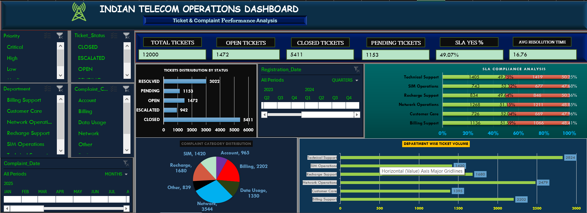
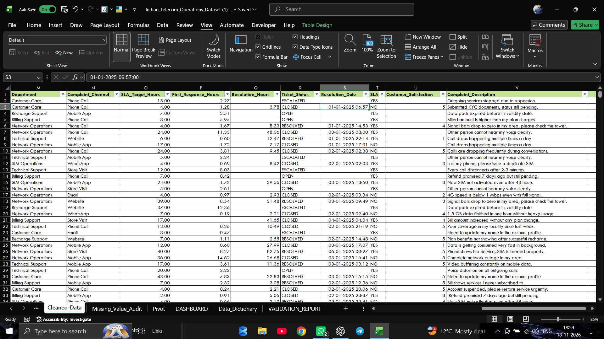
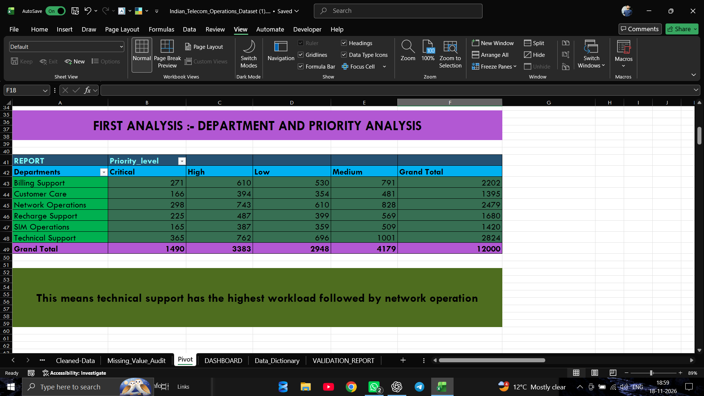
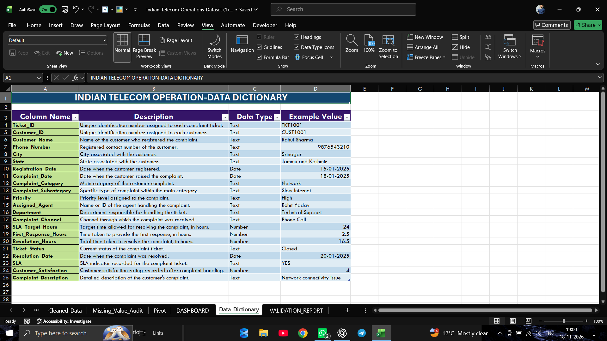
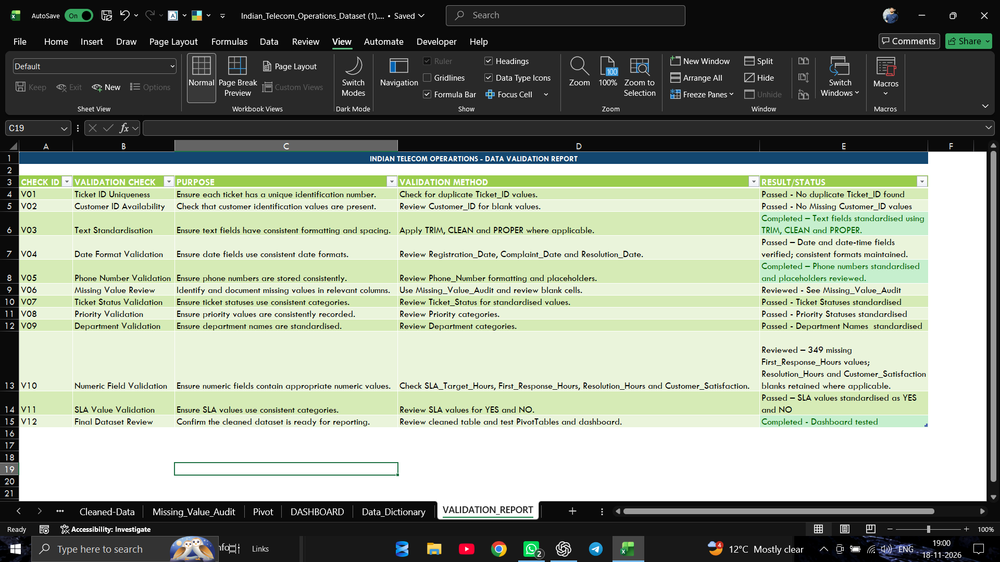

# Indian Telecom Operations – MIS Dashboard

An end-to-end **Microsoft Excel Data Analytics and MIS Reporting Project** focused on analysing telecom customer complaints, ticket management, department workload, and SLA indicators.

The project transforms raw telecom operations data into structured reports and an interactive Excel dashboard to support operational monitoring and data-driven decision-making.

## 📊 Dashboard Preview



## 📌 Project Overview

This project analyses an Indian telecom operations dataset containing **12,000 complaint records**. It demonstrates how Microsoft Excel can be used to clean operational data, perform MIS analysis, track key performance indicators (KPIs), and create an interactive dashboard.

The workbook includes raw data, cleaned data, PivotTables, a dashboard, a data dictionary, and a validation report.

## 🎯 Project Objectives

- Clean and standardise raw telecom complaint data.
- Analyse ticket distribution across departments and priorities.
- Monitor ticket statuses and complaint categories.
- Review department-wise SLA indicators.
- Calculate key operational KPIs.
- Build an interactive MIS dashboard using Excel.
- Present findings in a structured reporting format.

## 🛠️ Tools & Technologies

- Microsoft Excel
- Excel Tables
- PivotTables and PivotCharts
- Excel Slicers and Timelines
- Excel formulas and functions
- Conditional Formatting
- Data Cleaning and Validation
- MIS Reporting and Dashboard Design

## 🧹 Data Cleaning & Preparation

The raw dataset was preserved separately from the cleaned dataset within the same workbook.

Key preparation activities included:

- Standardising text fields using TRIM, CLEAN and PROPER.
- Reviewing missing values and documenting them.
- Standardising phone-number entries and placeholders.
- Checking date and date-time formats.
- Reviewing ticket IDs for duplicates.
- Standardising ticket status, priority and department categories.
- Retaining appropriate blanks where values were unavailable or not applicable.



## 📈 MIS Analysis & Reporting

The project includes the following five analytical sections:

1. **Department & Priority Analysis** – Examines ticket workload across departments and priority levels.
2. **Ticket Status Analysis** – Monitors Open, Closed, Pending, Resolved and Escalated tickets.
3. **SLA Compliance Analysis** – Reviews department-wise YES/NO SLA indicators.
4. **Department Performance Analysis** – Compares ticket volume, average resolution time and customer satisfaction.
5. **Complaint Category Distribution** – Examines complaint volumes across different categories.



## 📊 Interactive Dashboard

The Excel dashboard provides an overview of telecom complaint operations through KPI cards, charts, slicers and timelines.

### Key Performance Indicators

| KPI | Result |
|---|---:|
| Total Tickets | 12,000 |
| Open Tickets | 1,472 |
| Closed Tickets | 5,411 |
| Pending Tickets | 1,153 |
| SLA YES | 49.07% |
| Average Resolution Time | 16.76 Hours |

### Dashboard Features

- Department-wise ticket volume.
- Ticket status distribution.
- SLA YES/NO analysis.
- Complaint category distribution.
- Priority and department filters.
- Ticket status and complaint category slicers.
- Registration date and complaint date timelines.
- Interactive filtering for operational analysis.

## 📖 Data Dictionary

A separate Data Dictionary sheet documents the dataset fields, descriptions, data types and example values.



## ✅ Data Validation Report

A dedicated validation report documents the checks performed during data preparation, including:

- Ticket ID uniqueness.
- Customer ID availability.
- Text standardisation.
- Date and date-time validation.
- Phone number review.
- Missing-value review.
- Ticket status, priority and department validation.
- Numeric field validation.
- SLA category validation.
- Final dashboard review.



## 💡 Key Observations

Based on the PivotTable analysis:

- Technical Support recorded the highest ticket volume, with **2,824 tickets**.
- Network Operations followed with **2,479 tickets**.
- Billing Support recorded **2,202 tickets**.
- Closed tickets accounted for **5,411 records**.
- There were **1,490 Critical-priority tickets**.
- The overall SLA indicator distribution was **49.07% YES** and **50.93% NO**.

These observations help identify workload distribution, ticket status patterns and areas requiring further operational review.

## 📁 Repository Structure

```text
Indian-Telecom-Operations-MIS-Dashboard/
│
├── README.md
│
├── Dataset/
│   └── Original dataset 
│
├── Workbook/
│   └── Final Excel workbook (.xlsx)
│
└── screenshot/
    ├── Dashboard.png
    ├── Cleaned-Data.png
    ├── Pivot-analysis.png
    ├── Data-Dictionary.png
    └── Validation-Report.png
```

## 🚀 Skills Demonstrated

- Data Cleaning and Preparation
- Microsoft Excel
- MIS Reporting
- PivotTable Analysis
- KPI Development
- Interactive Dashboard Creation
- Data Validation
- Business Reporting
- Data Interpretation

## 👨‍💻 Author

**Arsalan Wani**

Aspiring Data Analyst | MIS Executive

GitHub: [arsalanwani](https://github.com/arsalanwani)

LinkedIn: [Connect with me](https://www.linkedin.com/in/arsalan-shafi2002/)

---

*This project was developed for practical learning and portfolio demonstration using Microsoft Excel.*